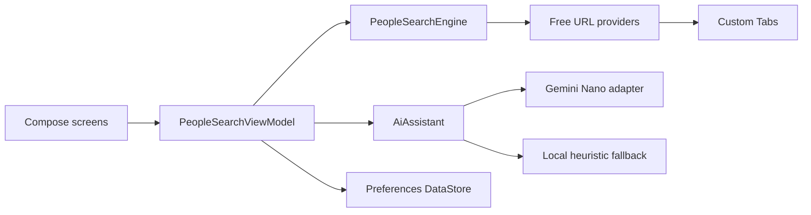

# Architecture

## Shape

Android People Search is a single-module, Android-first Compose application using unidirectional state flow:

## Boundaries

- `model`: immutable query, result, settings, confidence, and AI value objects.
- `search`: provider contract, pure URL encoding, catalog, deduplication, and explainable scoring.
- `ai`: device-AI abstraction, compile-safe Nano adapter, and deterministic fallback.
- `data`: settings plus opt-in search history. No database is created when history is disabled.
- `ui`: Compose screens, navigation, state holder, source opening, and copy actions.

Providers produce attributed browser targets, not scraped records. `requiresPayment` and `requiresAuth` are enforced by the engine. Adding a source requires tests and a source-matrix update.

## Security

Cleartext HTTP is disabled. Backups exclude local preferences. Release logging is disabled, no analytics SDK exists, and no background worker or hidden network client is included.
